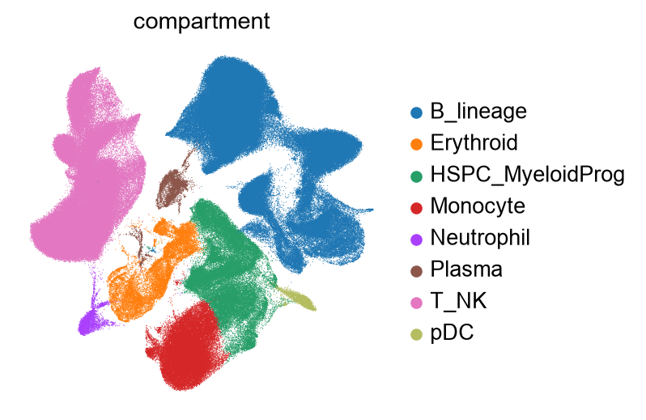

# Unsupervised cell clustering of human bone marrow (GEO GSE337533)

## The goal

Single-cell RNA sequencing measures which genes are active in each of hundreds of thousands of
individual cells. Nobody tells us what each cell is. **Unsupervised clustering** groups cells by
how similar their gene activity is, so cells of the same type or state end up together. We then
look at each group's characteristic genes to work out what it is.

This dataset profiles human bone marrow from 6 healthy donors and focuses on how B cells (the
antibody-producing immune cells) develop. I grouped every cell into clusters without using the
published cell-type labels or the associated paper.

## The result

About 432,000 cells were captured. After removing low-quality cells and doublets (two cells
captured together), **367,389 cells were grouped into 65 clusters** in 8 broad families: B-cell
lineage, T/NK cells, stem and early progenitors, monocytes, neutrophils, red-cell lineage, plasma
cells, and plasmacytoid dendritic cells (pDC). The B-cell clusters line up in the expected
developmental order, from the earliest pro-B cells through dividing pre-B cells to mature and
memory B cells.

## How it works

1. **Find real cells.** Separate cells from empty droplets, then remove damaged cells and
   doublets.
2. **Focus on informative genes.** Use the genes that vary most between cells. Antibody genes are
   left out because each B cell carries a unique antibody, which would split cells by that
   personal "barcode" rather than by cell type.
3. **Remove technical differences.** The data comes from 22 separate runs, so cells are aligned
   across runs so the same cell type groups together regardless of which run it came from.
4. **Cluster in two passes.** First split cells into broad families, then cluster each family
   again to reveal finer subtypes and developmental stages.
5. **Prefer reproducible clusters.** Keep only splits that come out the same across repeated
   runs, and merge clusters that don't differ by meaningful genes.
6. **Check against independent evidence.** The dataset also records each B cell's antibody
   (receptor) chains. This was never used for clustering, so it can independently test whether
   the B-cell clusters make sense.

Full details, thresholds and every judgment call are in [METHODS.md](METHODS.md).

## Why we trust it

B cells build their receptor in a fixed order: first a heavy chain, then a light chain, and only
mature cells switch antibody class. The clusters reproduce that order:

| Cluster type | Typical receptor state | Observed |
|---|---|---|
| Pro-B (earliest) | no receptor yet | 94% have no receptor chain |
| Pre-B | heavy chain only | 47-59% heavy chain only |
| Mature / memory B | heavy + light | ~60% heavy + light; class switching only in memory-like clusters |
| Plasma cells | heavy + light, class-switched | 95% heavy + light, 82-87% switched |
| Non-B cells | none | ~99% no receptor |

In addition, no single run dominates any main cluster (≤18%). Neutrophils are the exception
(33%) because only the whole-marrow samples contain them.

## Things to know

- **No protein data.** The files list ~137 surface-protein measurements, but they are all zero, so
  clustering uses RNA only.
- **One unreliable run.** Library `Bcell_2_2` (31,000 cells) shows mixed B-cell and myeloid signal
  that can't be corrected. It did not shape the clusters. Its cells were labelled by matching them
  to their most similar cells from other runs, and they are flagged in the output.
- **Doublet-like clusters are kept, not deleted.** 6,712 cells sit in 17 small clusters annotated
  "Doublet-like" or "ambient". Filter on the `annotation` column if you want to drop them.
- **Annotations are interpretation.** Cluster names come from marker genes. The cluster IDs are
  the primary result.

## Outputs

| File | What it is |
|---|---|
| `results/cell_clusters.csv` | **Main result:** each cell ID → cluster, annotation, family, run, donor, QC flag |
| `results/removed_cells.csv` | Cells removed before clustering, with the reason |
| `results/cluster_annotations.csv` | The 65 clusters with names and key marker genes |
| `results/vdj_validation_by_cluster.csv` | Receptor-chain check per cluster |
| `results/figures/`, `results/global/`, `results/sub/` | Plots and per-cluster summaries |

## Reproduce

Uses [pixi](https://pixi.sh) for packages. Run the scripts in `scripts/` in order (01 → 07). The
exact commands are in [METHODS.md](METHODS.md#reproduce). It takes about 2-3 hours on an M4 Pro
with 24 GB RAM.
